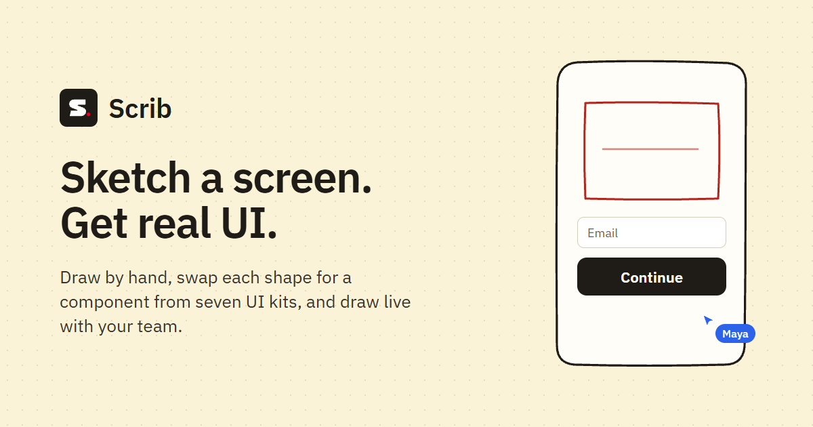
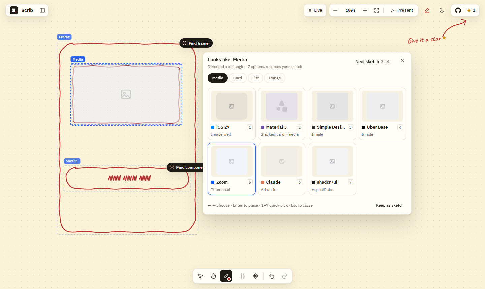
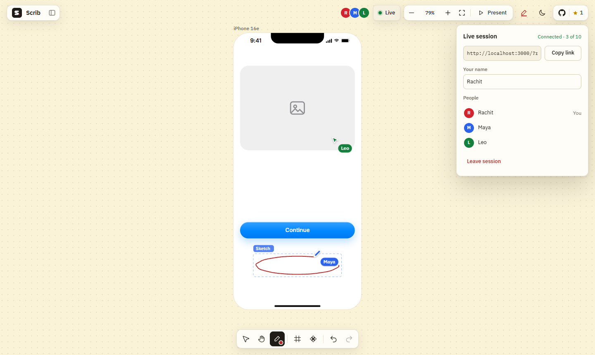
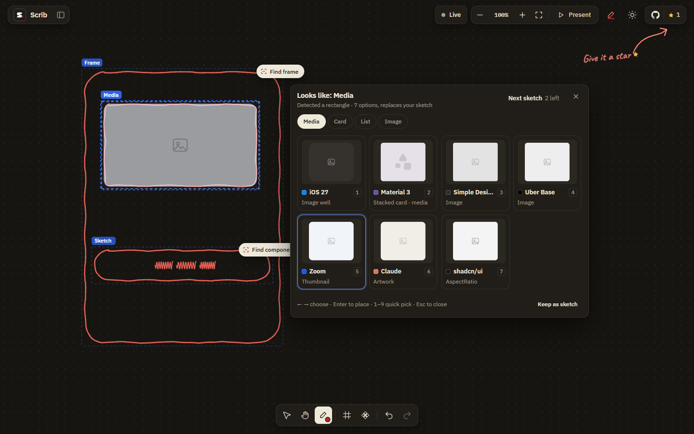

<p align="center">
  
</p>

<h1 align="center">Scrib</h1>

<p align="center">
  <b>Scribble a screen. Get real UI.</b><br>
  Draw boxes and squiggles. Scrib turns each one into a real component, and your whole team can draw at once.
</p>

<p align="center">
  <a href="https://github.com/Rachit315/Scrib/stargazers"></a>
  
  
</p>

<p align="center">
  <a href="#run-it">Run it</a> ·
  <a href="#deploy">Deploy</a> ·
  <a href="#draw-together">Live mode</a>
</p>



## How it works

1. **Scribble.** A tall outline, a pill with writing, a box with an X.
2. **Tap the tag.** Scrib works out what you meant and shows it from every kit.
3. **Pick one.** It lands on the canvas as a real, editable component inside a real device frame.



| You draw | You get |
| --- | --- |
| Tall outline | iPhone, Pixel or custom frame |
| Box with writing | Button |
| Thin empty box | Text field |
| Box with an X | Image |
| Circle | Avatar |

**Seven kits:** iOS 27 · Material 3 · Simple Design System · Uber Base · Zoom · Claude · shadcn/ui

## Draw together

Press **Live** and share the link. Up to **10 people** in one room:

- Named cursors that become a pencil when someone is drawing, or a hand when they pan
- Ink that appears stroke by stroke as it's drawn
- Every move, resize and delete syncs instantly
- Undo only touches your own work



## Light or dark

Follows your system, or pick one from the panel. Press <kbd>Shift</kbd> <kbd>D</kbd> to flip.



## Also in the box

Figma-style frames (nesting, clip content) · snapping and alignment · Present mode · copy and paste with Figma · React and HTML export · autosave

## Run it

```bash
git clone https://github.com/Rachit315/Scrib.git
cd Scrib
npm start        # http://localhost:3000
```

No dependencies and no build step: just Node 18 or later.

## Deploy

[](https://vercel.com/new/clone?repository-url=https://github.com/Rachit315/Scrib)

`vercel.json` serves `public/` as a static site. Live sessions run on [Supabase Realtime](https://supabase.com/docs/guides/realtime) (broadcast and presence; no tables needed). The project URL and publishable key live in [`public/live-config.js`](public/live-config.js). Leave them empty and `npm start` relays sessions itself through `server.js`.

## Under the hood

| File | What it does |
| --- | --- |
| `public/app.js` | Canvas, sketch recognizer, components, live sync (vanilla JS) |
| `public/kits.css` | The seven UI kits |
| `server.js` | Zero-dependency static server and live relay |

<p align="center">
  <sub>Made with a pencil. Finished with real components.<br>
  If Scrib saved you a sketch or two, <a href="https://github.com/Rachit315/Scrib">give it a ★</a>.</sub>
</p>
